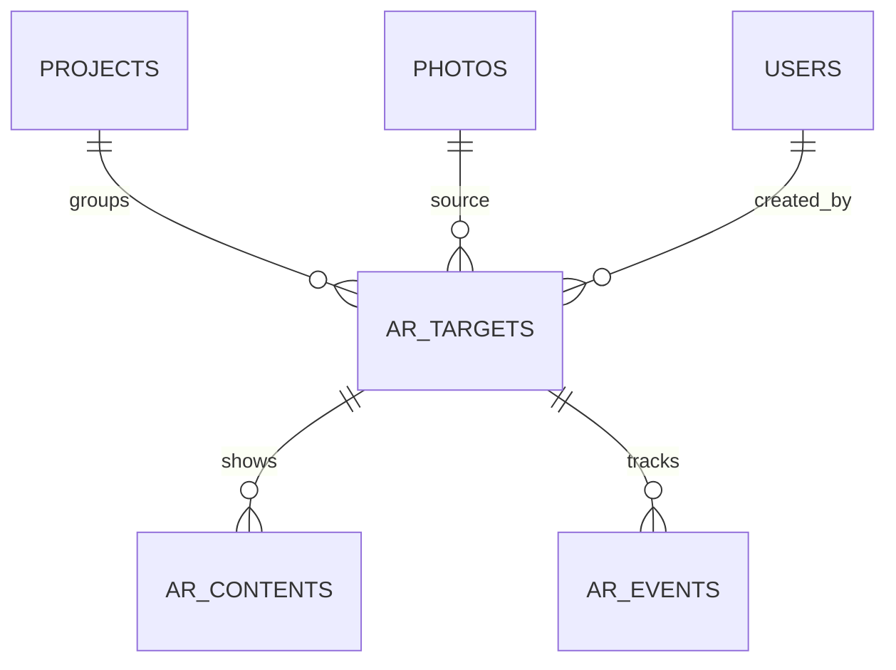

# D1.4 — Архитектура «оживающих фотографий» (предварительная)

**Дата:** 2026-10-27
**Статус:** принята на контрольной точке D1.5 (2026-10-27): собственная
реализация на текущей технологии (MindAR). Миграции, модели и
Filament-ресурсы создаются на D1.6/D1.10.

**Решения владельца (2026-10-27):**

1. Хранилище и трафик оплачивает владелец; фото и видео хранятся, пока
   оплачивается хранилище, в идеале много лет. Автоматического срока
   удаления нет.
2. Видео — **со звуком**: на странице нужен запрос на включение звука (§8.1).
3. Технология — текущая (MindAR 1.2.5). Проверка на iPhone откладывается
   до финального тестирования (D1.9); D1.5 принимается без неё.
4. На одном развороте альбома — не более одного таргета. **QR-код**
   печатается вместе с таргетным фото в альбоме и ведёт на AR-страницу (§3.1).

**Входные данные:** прототип `prototypes/webar` (MindAR 1.2.5), полевой тест
D1.3 (`docs/AR-D1.3-FIELD-PROTOCOL.md`), `database.md` (таблицы `projects`,
`albums`, `photos`, `media`, `videos`), roadmap D1.4/D1.7/D1.8.

---

## 1. Сценарии

**Администратор / фотограф (Filament):**

1. Создаёт AR-таргет: выбирает фото (из альбома проекта или загружает файл).
2. Браузер компилирует файл таргета (`.mind`) — прогресс на экране, ~10 с.
3. Загружает видео (или несколько, на будущее).
4. Получает публичную ссылку `/ar/{token}` и QR-код (§3.1), отдаёт фото
   с QR-кодом в вёрстку альбома.

**Зритель (без входа на сайт):**

1. Сканирует QR-код рядом с фото в альбоме (или открывает ссылку из
   мессенджера — проверено Telegram/Instagram/VK).
2. Нажимает «Старт», наводит камеру на напечатанное фото.
3. Поверх фото проигрывается видео; по запросу включается звук.

---

## 2. Сущности

Предлагаемая в roadmap цепочка
`Project → Album → Photo → AR Target → AR Content → Video Media` упрощена:

```text
Project ─┐ (необязательно, SET NULL)
         ├─< ar_targets >── photos (необязательно, SET NULL)
                 │
                 └─< ar_contents   (видео: файл и метаданные в самой строке)
                 └─< ar_events     (статистика, D1.6)
```

- **Отдельная сущность «Video Media» не вводится.** Файл видео и его
  метаданные хранятся в строке `ar_contents` — одна таблица вместо двух.
- **Таблица `videos` не используется.** Это раздел видео на сайте
  (`is_active`, `show_on_home`, привязки к альбомам/услугам/статьям); AR-видео
  клиентов там появляться не должны.
- **Таблица `media` не используется для файлов AR.** Причины: удаление `Media`
  каскадно удаляет `photos`; команда `media:migrate-to-yandex` переносит
  оригиналы на Яндекс.Диск, а AR-файлы должны жить отдельно (roadmap D1.7);
  `MediaAccessService` проверяет доступ через альбомы, а AR-контент открыт
  по ссылке. У AR — свои колонки `disk` + `path`, как у `media`.

### 2.1 `ar_targets` — напечатанная фотография, которую распознаёт камера

```sql
id BIGINT PRIMARY KEY

token VARCHAR(32) UNIQUE          -- публичный токен ссылки /ar/{token}

title VARCHAR(255)                -- «11А, общее фото» — для админки

project_id BIGINT NULL            -- для группировки и поиска
photo_id BIGINT NULL              -- фото альбома, из которого сделан таргет

disk VARCHAR(50)                  -- диск AR-файлов (env AR_DISK)
marker_path VARCHAR(1000)         -- изображение, из которого собран таргет
marker_width INT UNSIGNED
marker_height INT UNSIGNED        -- пропорции плоскости видео = height / width

tracker VARCHAR(30)               -- 'mindar' (формат файла таргета)
tracker_version VARCHAR(20)       -- '1.2.5'
target_path VARCHAR(1000) NULL    -- скомпилированный таргет (.mind)
feature_points INT UNSIGNED NULL  -- опорные точки на полном масштабе (качество)
compiled_at TIMESTAMP NULL

is_active BOOLEAN DEFAULT TRUE    -- выключатель публичной ссылки

created_by BIGINT NULL

created_at TIMESTAMP
updated_at TIMESTAMP
```

Foreign keys:

```sql
project_id -> projects.id ON DELETE SET NULL
photo_id   -> photos.id   ON DELETE SET NULL
created_by -> users.id    ON DELETE SET NULL
```

Indexes:

```sql
UNIQUE(token)
INDEX(project_id)
INDEX(photo_id)
INDEX(is_active)
```

### 2.2 `ar_contents` — что показывается поверх таргета

```sql
id BIGINT PRIMARY KEY

ar_target_id BIGINT

type VARCHAR(20) DEFAULT 'video'  -- на будущее: 'image', 'link'

disk VARCHAR(50)
file_path VARCHAR(1000)
mime_type VARCHAR(100)
file_size BIGINT UNSIGNED
width INT UNSIGNED NULL
height INT UNSIGNED NULL
duration_ms INT UNSIGNED NULL
has_sound BOOLEAN DEFAULT TRUE   -- есть звуковая дорожка (определяется при загрузке)

sort_order INT DEFAULT 0
is_active BOOLEAN DEFAULT TRUE

created_at TIMESTAMP
updated_at TIMESTAMP
```

Foreign keys:

```sql
ar_target_id -> ar_targets.id ON DELETE CASCADE
```

Indexes:

```sql
INDEX(ar_target_id, is_active, sort_order)
```

MVP показывает **первый активный** контент по `sort_order`. Несколько
контентов на одну фотографию (roadmap: «в будущем») уже допускаются схемой;
правило выбора (по дате, по кампании, по очереди) — задача после MVP.

### 2.3 `ar_events` — базовая статистика (D1.6, черновик)

```sql
id BIGINT PRIMARY KEY
ar_target_id BIGINT
event VARCHAR(30)        -- open, camera_started, target_found, video_started, error
session VARCHAR(64)      -- случайный id вкладки, без персональных данных
duration_ms INT UNSIGNED NULL   -- для этапов запуска (как в журнале прототипа)
user_agent VARCHAR(255) NULL
created_at TIMESTAMP
```

`ar_target_id -> ar_targets.id ON DELETE CASCADE`, `INDEX(ar_target_id, event, created_at)`.
IP не храним. Набор событий уточняется на D1.6.

---

## 3. Публичный токен

- 12 символов base62 из `random_bytes` (~71 бит): не угадывается и не связан
  с `id`, фото, альбомом или проектом.
- Создаётся один раз при создании таргета и **не меняется** при правке
  названия, замене видео, перекомпиляции и удалении альбома/фото.
- Перевыпуск — только явной кнопкой в админке (старая ссылка перестаёт
  работать; нужно для случая «ссылка утекла»).
- Выключение — `is_active = false`: страница отвечает «ссылка отключена»
  (HTTP 410), файлы не удаляются.
- Ссылка — это ключ доступа: кто знает токен, видит видео. Отдельной
  авторизации у зрителя нет (сценарий «отсканировал QR и смотрит»).
- **Ссылка привязана к фотографии, а не к пользователю.** Общее фото класса
  печатается во всех альбомах класса — у всех один и тот же QR и одна
  ссылка. Личное фото ученика — свой таргет и своя ссылка. Учётной записи
  у зрителя нет, поэтому «ссылка на пользователя» не нужна.
- Перевыпуск токена делает **напечатанные QR-коды недействительными** —
  форма перевыпуска предупреждает об этом; использовать только при утечке.

### 3.1 QR-код

- QR кодирует полный адрес `https://fotoskazkaufa.ru/ar/{token}` — короткий
  путь, чтобы код был мелким и читался с печати.
- В админке у таргета — кнопки «Скачать QR (SVG)» и «Скачать QR (PNG)» для
  вёрстки альбома; SVG — основной формат для печати (векторный).
- Генерация на сервере PHP-библиотекой QR (новая зависимость, выбор на D1.6:
  например `bacon/bacon-qr-code` или `chillerlan/php-qrcode`). Хранить QR
  не нужно — он однозначно получается из токена и строится по запросу.
- Рекомендации вёрстки: QR не меньше 2×2 см, белые поля вокруг (≥ 4 модуля),
  **не поверх** таргетного фото — иначе QR мешает распознаванию; рядом
  подпись «Наведите камеру — фото оживёт».
- Токен не меняется при правках (§3), поэтому напечатанный QR работает,
  пока таргет активен и хранилище оплачивается.

### 3.2 Несколько фото по одной ссылке

MindAR умеет распознавать **несколько изображений через одну ссылку**:
компилятор принимает массив фото и собирает один `.mind`, а на странице к
каждому таргету привязывается своё видео (`addAnchor(i)`). По умолчанию
одновременно отслеживается одно фото (`maxTrack: 1`) — для альбома этого
достаточно.

Цена: `.mind` растёт примерно на 0,5–0,9 МБ на фото, сопоставление каждого
кадра идёт по всем таргетам — после ~10 фото на ссылку запуск и
распознавание заметно замедлятся (порог проверяется на D1.9).

Решение для MVP: **одна ссылка (и один QR) — одно фото**. QR печатается
рядом со своим фото, поэтому общая ссылка не нужна. Если позже понадобится
«один QR на весь альбом», добавляется сущность-коллекция (`ar_collections`
с несколькими `ar_targets` и одним `.mind`) без изменения существующих
таблиц.

---

## 4. Хранение файлов

- **Срок хранения — без ограничения** (решение владельца): файлы живут,
  пока оплачивается хранилище. Автоматической очистки нет; удаление только
  явно из админки.
- Все AR-файлы — на отдельном диске Laravel Filesystem `ar`
  (`config/filesystems.php`, имя диска из `AR_DISK`). MVP — локальный диск,
  D1.7 — S3-совместимое хранилище (решение владельца 2026-10-25) ± CDN.
  Ключи — только в `.env`.
- Раскладка: `ar/targets/{id}/marker.jpg`, `ar/targets/{id}/target.mind`,
  `ar/targets/{id}/contents/{content_id}.mp4`. Путь по `id`, а не по токену —
  перевыпуск токена не двигает файлы.
- **Отдельно от клиентских альбомов:** таргет хранит **свою копию**
  изображения-маркера (уменьшенную до 1600 px — то, из чего собран `.mind`).
  Оригиналы клиентских альбомов на Яндекс.Диске можно удалить — AR это
  не затронет.
- Отдача: `.mind` и видео нужны публичной странице без входа. На локальном
  диске — через nginx (как статика, с gzip для `.mind`); на S3 — прямой URL
  или временная подписанная ссылка (`temporaryUrl`), выбор на D1.7.
  На видео — дети, поэтому предпочтение подписанным ссылкам с жизнью в
  несколько часов: прямой URL файла без токена страницы не живёт долго.
- Требования к видео (D1.8): H.264 + `yuv420p` + `faststart`, звук AAC,
  пропорции кадра = пропорции маркера, лимит размера и длительности —
  задаются на D1.8.

---

## 5. Жизненный цикл относительно клиентского альбома

| Событие | Что происходит с AR |
|---|---|
| Удалено фото из альбома (`photos`) | `ar_targets.photo_id → NULL`, таргет и ссылка работают |
| Удалён альбом | каскадно удаляются `photos` → то же, `photo_id → NULL` |
| Удалён/перенесён на Яндекс.Диск `Media` оригинала | не влияет: у таргета своя копия маркера |
| Проект в статусе «Архив» или удалён | `project_id → NULL` при удалении; ссылка работает |
| Таргет выключен (`is_active = false`) | ссылка отвечает 410, файлы на месте |
| Таргет удалён администратором | удаляются `ar_contents`, `ar_events` и файлы диска `ar` |

AR-контент удаляется **только явно** — через админку AR.

---

## 6. Компиляция таргета

**Выбрано: в браузере, прямо в Filament** (условие владельца «меньше минуты»
выполнено с большим запасом).

Замер (`prototypes/webar/public/compile.html`, Chromium, ноутбук с Intel HD
Graphics 2000 — видеокарта 2011 года, 4 потока CPU):

| Фото | Исходник → таргет | Время | `.mind` | Опорные точки |
|---|---|---|---|---|
| Фото класса | 5668×3771 → 1600×1065 | **9,5 с** | 909 КБ | 245 / 213 |
| Образец FS-001 | 1648×1248 → 1600×1212 | **7,4 с** | 552 КБ | 178 / 148 |

Для сравнения: офлайн-компиляция в Node (TensorFlow.js на CPU) — 52 с.
Запасной вариант «Node на сервере в очереди» не нужен; если у администратора
нет WebGL, форма показывает ошибку и не даёт сохранить таргет.

UX в Filament:

1. Администратор выбирает фото → JS уменьшает его до 1600 px по длинной
   стороне (canvas) и компилирует (Web Worker MindAR), показывая прогресс.
2. После компиляции — карточка качества: число опорных точек; меньше ~60 —
   предупреждение «фото слабое для распознавания» (сохранить можно).
3. На сервер уходят уменьшенный маркер (JPEG) и `.mind`; сервер проверяет
   типы и размеры (D1.8) и записывает их на диск `ar`.
4. Замена фото → маркер и `.mind` пересобираются заново; старые файлы
   удаляются после успешного сохранения. Ссылка (токен) не меняется, но
   старые отпечатки перестанут распознаваться — форма предупреждает об этом.
5. Ошибка компиляции (нет WebGL, битый файл) — сообщение, сохранение
   невозможно, исходное состояние таргета не меняется.

Перед печатью: печатается **то же изображение без обрезки** (пропорции
отпечатка = пропорции маркера). Размеры маркера хранятся явно
(`marker_width/height`), чтобы видео на странице ложилось ровно по фото —
браузер и офлайн-компилятор округляют высоту по-разному (1065 против 1064).

**Без привязки к SDK:** `tracker` + `tracker_version` описывают формат файла
таргета. При смене SDK (D1.5) таргеты пересобираются из хранимого маркера,
ссылки и видео не меняются.

---

## 7. Контроль доступа

- **Админка:** Filament-ресурс AR, роли `admin` и `photographer` — как
  `AlbumPolicy`/`ProjectPolicy`. `client`, `parent`, `class_manager` доступа
  не имеют.
- **Публичная страница** `GET /ar/{token}`: без входа; 404 для неизвестного
  токена, 410 для выключенного; `throttle` на маршрут; `noindex`
  (`X-Robots-Tag`, meta robots); в sitemap не попадает.
- **События статистики** `POST /ar/{token}/events`: `throttle`, только для
  активного таргета, без персональных данных.

---

## 8. Публичная страница

- Laravel-маршрут вместо статического `/webar/`: Blade-шаблон отдаёт ту же
  страницу, что прототип, с конфигом таргета (URL `.mind`, пропорции маркера,
  URL видео) в JSON.
- JS и вендорные библиотеки — из прототипа (`app.js`, MindAR, three.js),
  с версией в адресе против кэша CDN.
- Сохраняется найденное на D1.3: предзагрузка `.mind` параллельно с камерой,
  gzip для `.mind`, видео `playsinline`, разблокировка жестом «Старт»,
  пауза при потере таргета.

### 8.1 Звук

Браузеры (особенно iOS Safari) запускают видео со звуком только после жеста
пользователя. Порядок:

1. Нажатие «Старт» — это жест: в нём видео запускается **со звуком** и сразу
   ставится на паузу («разблокировка»). Если браузер разрешил — дальше видео
   при распознавании играет со звуком без дополнительных касаний.
2. Если браузер отказал (`NotAllowedError`) или страница открыта во
   встроенном браузере, который блокирует звук, — видео играет без звука,
   а поверх него появляется кнопка **«🔊 Включить звук»**. Касание кнопки —
   новый жест: `muted = false` и `play()`.
3. Кнопка «Без звука / Со звуком» доступна всё время, пока видео на экране.
4. У видео без звуковой дорожки (`ar_contents.has_sound = false`) кнопки нет.

---

## 9. Перечень для `database.md` (после D1.5, без миграций сейчас)



| Таблица | Назначение | Этап |
|---|---|---|
| `ar_targets` | таргет, токен, маркер, файл трекера | D1.6 |
| `ar_contents` | видео поверх таргета | D1.6 |
| `ar_events` | статистика открытий и запусков | D1.6 (минимум) / D1.8 |

Существующие таблицы не меняются.

---

## 10. Вопросы D1.5 — закрыты 2026-10-27

| Вопрос | Решение |
|---|---|
| QR-код | печатается рядом с таргетным фото в альбоме, генерируется в админке (§3.1) |
| Срок хранения и оплата | платит владелец; хранится, пока оплачено хранилище, без автоудаления (§4) |
| Звук | видео со звуком, запрос на включение звука (§8.1) |
| iPhone | откладывается до D1.9; риск: если сценарий не заработает на iPhone, на D1.9 рассматривается AR.js / 8th Wall или коммерческий трекинг — схема данных от этого не меняется (`tracker`) |
| Несколько таргетов | на развороте не более одного; одна ссылка — одно фото; несколько фото по ссылке технически возможно (§3.2) |
